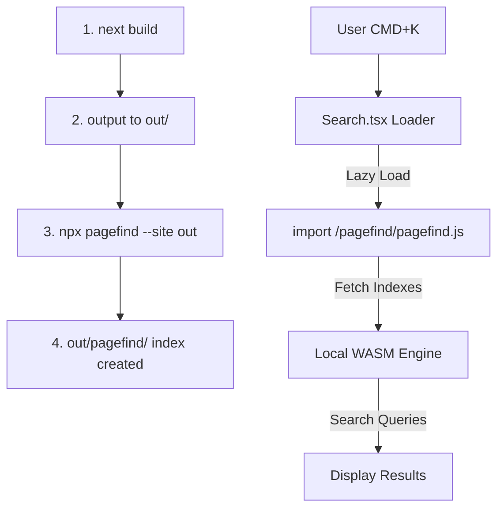
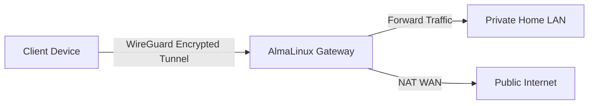
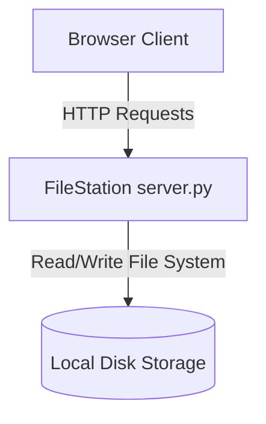

# imagitech.online Operations and Content Manual

Welcome to the operations manual and developer handbook for [imagitech.online](https://imagitech.online). 

This project functions as a high-density technical notebook, professional engineering portfolio, and documentation portal. It houses architectural diagrams, systems engineering guides, virtualization checklists, networking configurations, and post-mortems. The system is designed for maximum reading density, speed, accessibility, and zero-javascript-overhead content loading where possible.

---

## 1. System Architecture

The site is built as a statically exported [Next.js](https://nextjs.org/) application leveraging React, TypeScript, Tailwind CSS v4, and dynamic MDX processing. It features keyboard-navigable client-side search via [Pagefind](https://pagefind.app/) and uses a custom Clay-Copper design system.

### 1.1 Directory Tree

Below is the directory structure layout, showing where configuration, code, and content are separated:

```text
imagitech-online/
├── .github/
│   └── workflows/
│       └── cloudflare-pages.yml  # CI/CD deployment pipeline to Cloudflare Pages
├── content/                     # MDX Content Repository (separated by type)
│   ├── blog/                    # Long-form engineering articles and logs
│   ├── notes/                   # High-density code cheatsheets and command lists
│   └── projects/                # Production infrastructure case studies
├── public/                      # Static assets served at the root (favicons, feeds)
├── src/
│   ├── app/                     # App Router static pages and layout configurations
│   │   ├── about/               # Static "About" page
│   │   ├── blog/                # Blog lists and dynamic post parser page
│   │   ├── contact/             # Contact information page
│   │   ├── notes/               # Notes indexing and rendering sub-routes
│   │   ├── now/                 # Status log ("Now" page)
│   │   ├── projects/            # Project showcase routes
│   │   ├── uses/                # Hardware/software tooling index ("Uses")
│   │   ├── globals.css          # Design system variables, animations, scrollbars
│   │   ├── layout.tsx           # Global RootLayout, font loading, HTML shell
│   │   ├── page.tsx             # Main dashboard landing page
│   │   ├── robots.ts            # Dynamic robots.txt generation
│   │   └── sitemap.ts           # Dynamic sitemap.xml generation
│   ├── components/              # Reusable React components
│   │   ├── Callout.tsx          # Styled markdown notice containers (tip/warning/etc.)
│   │   ├── CodeBlock.tsx        # Copyable syntax-highlighted code container with copy button
│   │   ├── Footer.tsx           # Footer with system uptime indicators and spacers
│   │   ├── Header.tsx           # Sticky navigation header navbar
│   │   ├── Mdx.tsx              # Core MDX engine renderer mapping HTML to components
│   │   ├── Mermaid.tsx          # Client-side renderer for flowcharts and diagrams
│   │   ├── Search.tsx           # Keyboard-navigable search portal overlay (React Portal)
│   │   └── TableOfContents.tsx  # Dynamic side-menu outlining headings
│   ├── lib/                     # Technical helper libraries and scripts
│   │   ├── mdx.ts               # File system parser, slug resolver, and TOC extractor
│   │   └── rss.ts               # Automated RSS xml compilation generator
│   └── types.ts                 # Main TypeScript definitions for articles/projects/notes
├── next.config.ts               # Next.js compiler settings (static export, unoptimized images)
├── server.js                    # Node.js production server for local previews and MIME mapping
├── tsconfig.json                # TypeScript configurations
└── package.json                 # Project dependencies, scripts, and build tasks
```

### 1.2 Routing Logic

```mermaid
graph TD
    Request[HTTP Request] --> Router{Next.js App Router}
    Router -->|Static Route /about| Static[src/app/about/page.tsx]
    Router -->|Dynamic Route /blog/:slug| DynamicBlog[src/app/blog/[slug]/page.tsx]
    Router -->|Dynamic Route /projects/:slug| DynamicProj[src/app/projects/[slug]/page.tsx]
    Router -->|Dynamic Route /notes/:slug| DynamicNote[src/app/notes/[slug]/page.tsx]
    
    DynamicBlog -->|Extract params| Slug[getBlogPostBySlug slug]
    Slug -->|FS Read| File[content/blog/slug.mdx]
    File -->|Parse Frontmatter| Matter[gray-matter]
    Matter -->|Render Body| Engine[next-mdx-remote/rsc]
```

*   **App Router Static Routes**: Simple static routes are defined directly as page folders in `src/app/`. These include directories like `about/`, `contact/`, `now/`, and `uses/`.
*   **Dynamic MDX Routes**: Dynamic folders (`blog/[slug]`, `projects/[slug]`, `notes/[slug]`) catch path requests and parse corresponding files from `content/`. During compile time, the framework invokes `generateStaticParams()` to fetch lists of all available Markdown slugs, pre-rendering every file as a standalone static HTML file.
*   **Zero Server-Side Dependency**: Because `next.config.ts` enforces `output: "export"`, routing does not rely on a Node.js server. Instead, routes map directly to physical HTML files on the file system (e.g., `/blog/my-post` matches `/blog/my-post.html`).

### 1.3 The MDX Processing System

All content in `content/` is parsed and compiled using a modular processing engine in [Mdx.tsx](file:///home/azureuser/imagitech-online/src/components/Mdx.tsx):

1.  **Metadata Extraction**: [mdx.ts](file:///home/azureuser/imagitech-online/src/lib/mdx.ts) reads files via Node's `fs` module, using **gray-matter** to separate frontmatter key-value pairs (like `title`, `date`, `tags`) from the main body.
2.  **Compilation**: The compiler uses `MDXRemote` from **next-mdx-remote/rsc** to transform markdown content into dynamic React nodes.
3.  **AST Transformation Plugins**:
    *   `remark-gfm`: Injects support for GitHub Flavored Markdown (including tables, checkboxes, strikethroughs, and raw links).
    *   `remarkMermaid` (Custom Plugin): An AST-walker that detects code blocks written with the `mermaid` language identifier and converts them to `<Mermaid chart="..." />` JSX flow elements.
    *   `rehype-slug`: Generates unique kebab-case IDs automatically from heading text (`h1`, `h2`, `h3`, etc.) to provide page-level section anchoring.
    *   `rehype-autolink-headings`: Wraps headings in links pointing to their generated IDs. Uses the `subtle-anchor` CSS class to display a `#` symbol on hover.
    *   `rehype-pretty-code` & **Shiki**: Inspects code fences to support syntax highlighting. It utilizes a custom Clay-Copper theme, disables default code background overrides (`keepBackground: false`), and handles specific line highlights (e.g. `{3-5}`) and title tags.
4.  **Tag-to-Component Mapping**: HTML tags inside MDX are mapped directly to custom styled React components:
    *   `a` maps to custom links that handle internal Next.js transitions or enforce target `_blank` for external destinations.
    *   `pre` maps to [CodeBlock.tsx](file:///home/azureuser/imagitech-online/src/components/CodeBlock.tsx), wrapping Shiki output in a container that renders code titles, language tags, and a fallback clipboard copy button.
    *   `Callout` and `Mermaid` are registered globally within the MDX component context to allow authors to invoke them directly.

### 1.4 Component Layout Boundaries

*   **HTML Outer Boundary**: Managed in [layout.tsx](file:///home/azureuser/imagitech-online/src/app/layout.tsx), which loads the Geist web fonts, defines global variables `--font-geist-sans` and `--font-geist-mono`, and structures the skip-to-content accessibility link.
*   **Sticky Navbar & Navigation Portal**: Managed by [Header.tsx](file:///home/azureuser/imagitech-online/src/components/Header.tsx). It includes navigation links, mobile responsive menu transitions, and mounts the search triggers.
*   **Keyboard Portal Search Overlay**: Defined in [Search.tsx](file:///home/azureuser/imagitech-online/src/components/Search.tsx). To prevent parent flex constraints from cropping overlays, the search modal uses a **React Portal** that mounts directly at `document.body` when active.
*   **Uptime Footer**: Configured in [Footer.tsx](file:///home/azureuser/imagitech-online/src/components/Footer.tsx), which renders site copyright metadata, automated year calculations, and a pulse status dot indicator signifying server operational integrity.

### 1.5 Static Export & Pagefind Search Indexing

Unlike traditional apps that search via server-side databases (like PostgreSQL or Elasticsearch), `imagitech.online` employs an offline client-side search engine.



1.  **Compilation Output**: The Next.js pipeline outputs statically generated files to the `out/` directory.
2.  **Indexing Pipeline**: Post-compilation, `npx pagefind --site out` parses all HTML output in the `out/` directory, extracts textual content, builds custom indices, and generates WebAssembly search binaries under `out/pagefind/`.
3.  **Lazy Loading Strategy**: To keep page load times fast, search resources are not loaded on page load. When a user presses `CMD+K`, `CTRL+K`, or `/`, the [Search.tsx](file:///home/azureuser/imagitech-online/src/components/Search.tsx) component uses a dynamic import (marked with a `/* webpackIgnore: true */` comment to bypass compile-time bundler checks) to fetch `/pagefind/pagefind.js`.
4.  **Local Execution**: The search engine runs directly on the user's browser thread using WebAssembly. This approach keeps queries fast and avoids network latency.
5.  **MIME Type Constraint**: Web servers hosting this application must serve `.wasm` assets using the header `Content-Type: application/wasm`. Without this header, browser engines will block the WebAssembly code from compiling, which disables search functionality.

---

## 2. Local Setup and Development

Follow these steps to run, build, and maintain the codebase.

### 2.1 Dependencies Installation

The project requires **Node.js v18.0.0 or higher** and uses npm.

```bash
# Clone the repository and navigate to the directory
cd /home/azureuser/imagitech-online

# Perform clean dependency installation using the lockfile
npm ci
```

### 2.2 Running Development Server

Start the Next.js development server:

```bash
npm run dev
```

The site will be active at [http://localhost:3000](http://localhost:3000).

> [!NOTE]
> During local development, the search overlay displays mock placeholder results because the Pagefind search indexes are compiled post-build and are not refreshed dynamically in dev mode.

### 2.3 Production Compilation

Build the website and generate the search indexes:

```bash
npm run build
```

This script:
1. Compiles the Next.js code.
2. Exports the raw static files to the `out/` folder.
3. Automatically triggers RSS feed compilation.
4. Crawls the `out/` directory with `pagefind` to build the WebAssembly search index.

### 2.4 Code Verification (Linting & Typechecking)

Ensure all files pass standard rules before committing changes:

```bash
# Run ESLint validation checks
npm run lint

# Run TypeScript compiler verification (Strict Typecheck)
npx tsc --noEmit
```

### 2.5 End-to-End (E2E) Testing

To run End-to-End tests, the site must be compiled and served on a local port. You can configure E2E testing framework packages (like **Playwright** or **Cypress**) to validate routing, accessibility, and search functionality.

```bash
# 1. First, compile the application
npm run build

# 2. Spin up the production-grade static preview server (runs on port 80)
# (Needs root privileges to bind to port 80. Alternatively, edit server.js to use another port)
sudo node server.js

# 3. In a separate terminal, install Playwright (if not already installed)
npm install -D @playwright/test
npx playwright install

# 4. Execute E2E tests against the running server
npx playwright test
```

---

## 3. Writing and Formatting Content

Content is organized in the `content/` folder. The system parses and renders MDX files according to their frontmatter metadata and location.

| Content Type | Storage Directory | Primary Purpose | Key Fields |
| :--- | :--- | :--- | :--- |
| **Blog Posts** | `content/blog/` | Long-form technical logs, post-mortems, system guides | `title`, `description`, `date`, `published`, `tags` |
| **Projects** | `content/projects/` | Structural project specs, case studies, open-source work | `title`, `description`, `github`, `url`, `technologies`, `featured` |
| **Notes** | `content/notes/` | High-density cheatsheets, CLI manuals, commands | `title`, `date`, `category`, `published` |

### 3.1 Writing a New Blog Post

Create your post at `content/blog/your-post-slug.mdx`. The file name must match the URL slug.

#### Required Frontmatter Fields

*   `title` (string): The title of your post. Keep it concise.
*   `description` (string): A short summary displayed in the feed and used for SEO meta tags.
*   `date` (string): Publication date formatted as `YYYY-MM-DD`. Used for feed sorting.
*   `published` (boolean): Set to `false` to save the post as a draft and prevent it from rendering.
*   `tags` (array of strings): Technical categories used for metadata sorting.

#### Complete Copy-Pasteable Blog Post Example

```markdown
---
title: "Self-Hosting a VPN Server on AlmaLinux"
description: "A comprehensive guide on deploying a secure WireGuard VPN server with containerization and automated firewall rules."
date: "2026-06-30"
published: true
tags: ["AlmaLinux", "WireGuard", "VPN", "Docker", "Networking"]
---

Setting up a VPN server is essential for securing remote access to home servers and private networks. In this post, I document how I self-host a WireGuard VPN server inside a Docker container on AlmaLinux 9, with automated configuration and routing.

## Why WireGuard?

WireGuard is a fast, simple, and modern VPN that uses secure cryptography. Compared to OpenVPN, it is lightweight, runs in kernel space, and connects quickly.

Here is the system architecture:



## Docker Compose Setup

I run WireGuard using the Linuxserver Docker image, which simplifies the setup.

```yaml title="docker-compose.yml" {8-12}
services:
  wireguard:
    image: lscr.io/linuxserver/wireguard:latest
    container_name: wireguard
    cap_add:
      - NET_ADMIN
      - SYS_MODULE
    environment:
      - PUID=1000
      - PGID=1000
      - TZ=Etc/UTC
      - SERVERURL=vpn.imagitech.online
      - SERVERPORT=51820
      - PEERS=laptop,phone,tablet
      - PEERDNS=1.1.1.1
      - INTERNAL_SUBNET=10.13.13.0
    ports:
      - 51820:51820/udp
    volumes:
      - ./config:/config
      - /lib/modules:/lib/modules
    sysctls:
      - net.ipv4.conf.all.src_valid_mark=1
    restart: unless-stopped
```

### Scripted Configuration

To enable network address translation (NAT) and forward traffic, configure IPv4 packet forwarding on the host system:

```bash
# Enable IPv4 forwarding temporarily
sudo sysctl -w net.ipv4.ip_forward=1

# Make the configuration permanent
echo "net.ipv4.ip_forward=1" | sudo tee -a /etc/sysctl.d/99-sysctl.conf
sudo sysctl --system
```

<Callout type="warning" title="Security Notice">
Ensure your firewall (firewalld or UFW) allows incoming UDP traffic on port 51820, and configure masquerading on your external network interface to prevent IP leaks.
</Callout>

To learn more about setting up Linux gateways, refer to [Useful Linux Networking Commands](file:///home/azureuser/imagitech-online/content/notes/linux-networking.mdx).
```

### 3.2 Writing a New Project Case Study

Projects are placed under `content/projects/your-project-slug.mdx`.

#### Required Frontmatter Fields

*   `title` (string): Project name.
*   `description` (string): A short overview of the project's purpose.
*   `date` (string): Project release date (`YYYY-MM-DD`).
*   `github` (string): URL to the GitHub repository.
*   `url` (string, optional): Live demo URL.
*   `technologies` (array of strings): Technologies used.
*   `featured` (boolean): Set to `true` to showcase the project on the home page dashboard.
*   `published` (boolean): Set to `true` to publish the project.

#### Complete Project Template

```markdown
---
title: "FileStation"
description: "A production-ready, ultra-lightweight single-file Python web file manager with chunked uploads."
date: "2026-06-15"
github: "https://github.com/DDreamer01/filestation"
url: "https://filestation.imagitech.online"
technologies: ["Python", "HTML5", "Vanilla JS", "Tailwind CSS", "Systemd"]
featured: true
published: true
---

## Overview

FileStation is a lightweight, single-file Python web server that provides a web interface for file storage and management on server directories.

## Problem

When managing remote Linux systems, configuring tools like FTP can be tedious and requires specialized clients, while heavy services like Nextcloud can be resource-intensive for simple storage nodes. I needed a tool that was:
1. Instantly deployable with no external Python dependencies.
2. Capable of handling large files (5GB+ ISOs) over unstable connections.
3. Accessible via standard web browsers on both mobile and desktop.

## Architecture

FileStation is contained in a single `server.py` file to simplify deployment. The backend uses Python's standard `http.server` library running on multi-threaded sockets.



## Features

- **Single-File Architecture**: Deploy and run `server.py` in any directory.
- **Resumable Chunked Uploads**: Resume file uploads after network failures without losing progress.
- **Folder Drag-and-Drop**: Upload directory structures recursively using browser APIs.
- **SSL Integration**: Natively handles HTTPS redirects and certificate renewals.

## Usage

Run the automated installer script:

```bash
chmod +x install.sh
sudo ./install.sh
```

Or start the server manually:

```bash
python3 server.py -d /home/user/files -u admin --password secret
```
```

### 3.3 Writing a New Technical Note

Notes are short-form developer cheatsheets, command logs, or diagnostic checklists. They are stored in `content/notes/your-note-slug.mdx`. 

Unlike blog posts or project case studies, notes do not require narrative summaries. They focus on providing reference commands and configurations.

#### Required Frontmatter Fields

*   `title` (string): Cheatsheet title.
*   `date` (string): Last update date (`YYYY-MM-DD`).
*   `category` (string): The category of the note (e.g., `Linux`, `Docker`, `SQL`, `Nginx`).
*   `published` (boolean): Set to `true` to publish.

#### Complete Technical Note Example

```markdown
---
title: "Useful Linux Networking Commands"
date: "2026-06-20"
category: "Linux"
published: true
---

A collection of quick commands for diagnosing networking issues on Linux servers.

### 1. Check Listening Ports
To see which processes are listening on which ports, use `ss`:

```bash
# -t: TCP, -u: UDP, -l: Listening, -p: Process, -n: Numeric port numbers
sudo ss -tulpn
```

### 2. Trace Route with Network Paths
Use `mtr` to view real-time latency statistics along a network path:

```bash
mtr -c 10 -r 8.8.8.8
```

### 3. Check Domain Name Resolution (DNS)
Check if local DNS servers are resolving names correctly using `dig`:

```bash
# Query a specific DNS server
dig @1.1.1.1 google.com

# Trace the DNS resolution path
dig +trace google.com
```

### 4. Capture Network Packets
Analyze raw network traffic on a specific interface:

```bash
sudo tcpdump -i eth0 -n -c 100
```
```

### 3.4 Writing Guidelines

To maintain content quality, adhere to the following writing guidelines:

*   **Experience-Driven Content**: Document actual engineering problems, real configuration settings, and verified CLI outputs. Avoid generic tutorials.
*   **Technical Accuracy**: Verify commands, configurations, and scripts locally before publishing.
*   **Conciseness and Clarity**: Get straight to the point. Provide a system architecture diagram (using Mermaid) for complex setups.
*   **No AI Filler**: Avoid generic introductions or AI-generated transition phrases. Ensure the content remains technical, detailed, and direct.
*   **Highlight Failure Modes**: Document the errors you encountered, how you diagnosed them, and the steps taken to resolve them.

---

## 4. Deployment Pipeline

The website is hosted on Cloudflare Pages. The build and deployment pipeline is automated using GitHub Actions.

### 4.1 GitHub Actions CI/CD Pipeline

The deployment workflow is defined in [cloudflare-pages.yml](file:///home/azureuser/imagitech-online/.github/workflows/cloudflare-pages.yml) and triggers automatically on pushes to the `main` branch:

```yaml
name: Deploy to Cloudflare Pages

on:
  push:
    branches:
      - main
  pull_request:
    branches:
      - main

jobs:
  deploy:
    runs-on: ubuntu-latest
    name: Build & Deploy
    steps:
      - name: Checkout code
        uses: actions/checkout@v4

      - name: Setup Node.js
        uses: actions/setup-node@v4
        with:
          node-version: 20
          cache: "npm"

      - name: Install dependencies
        run: npm ci

      - name: Build Next.js & Index Pagefind
        run: npm run build

      - name: Deploy to Cloudflare Pages
        uses: cloudflare/pages-action@v1
        with:
          apiToken: ${{ secrets.CLOUDFLARE_API_TOKEN }}
          accountId: ${{ secrets.CLOUDFLARE_ACCOUNT_ID }}
          projectName: imagitech-online
          directory: out
          gitHubToken: ${{ secrets.GITHUB_TOKEN }}
```

### 4.2 Configuration Parameters

*   **GitHub Secrets**:
    *   `CLOUDFLARE_API_TOKEN`: API Token generated in the Cloudflare Dashboard with permission to edit Pages projects.
    *   `CLOUDFLARE_ACCOUNT_ID`: Cloudflare Account ID.
    *   `GITHUB_TOKEN`: Built-in GitHub Action execution token used to publish commit status updates.
*   **Build Settings**:
    *   Framework Preset: `None` (handled by GitHub Actions outputting directly to the `out/` directory).
    *   Production Branch: `main`.

### 4.3 Custom Domains & DNS Configuration

1. In the Cloudflare Dashboard, navigate to **Workers & Pages** > **imagitech-online** > **Custom Domains**.
2. Click **Set up a custom domain** and enter `imagitech.online` (or your subdomain, e.g. `filestation.imagitech.online`).
3. Cloudflare will automatically configure the CNAME records in your DNS zone pointing to the Pages canonical URL (`imagitech-online.pages.dev`).

### 4.4 Rollbacks

If a bad deployment is pushed to production:
1. Open the Cloudflare Dashboard and navigate to **Workers & Pages** > **imagitech-online**.
2. Under the **Deployments** tab, locate the last known working deployment.
3. Click the three dots icon next to the deployment, and select **Rollback to this deployment**.
4. To fix the issue in the repository, revert the bad commit locally and push the clean history to the `main` branch on GitHub:
   ```bash
   # Revert the most recent commit on main
   git revert HEAD
   git push origin main
   ```

---

## 5. Maintenance and Code Preservation

To maintain the design layout and prevent regressions, adhere to the following maintenance rules:

### 5.1 CSS Custom Properties Protection

All colors are controlled by CSS variables defined in [globals.css](file:///home/azureuser/imagitech-online/src/app/globals.css). Do not replace these variables with hardcoded Tailwind color utilities (such as `bg-zinc-800` or `text-amber-500`).

```css
/* Maintain these main theme tokens inside globals.css */
--background: #181818;
--foreground: #F2F2F2;
--card: #222222;
--border: #353535;
--primary: #CF7253; /* Primary Accent Clay */
```

If you modify theme components, use semantic class wrappers (`bg-card`, `border-border`, `text-primary`) to ensure color consistency across the site.

### 5.2 Layout Integrity

Keep component margins, paddings, and flex structures clean.
*   Do not add custom margins inside page templates that could break the global max-width layout wrapper (`max-w-5xl px-4 sm:px-6 lg:px-8`).
*   Ensure that page components are responsive and adapt properly to mobile layouts.
*   When editing the header or footer, test the layout locally to prevent header occlusion issues (`scroll-margin-top: 5.5rem` is configured to prevent heading elements from being hidden behind the sticky header).

### 5.3 Zero-Regression Verifications

Before committing any layout changes, script edits, or dependency updates, run the following verification checklist:

```bash
# 1. Clean build cache
rm -rf .next out

# 2. Run strictly typed compilation checks
npx tsc --noEmit

# 3. Run style and syntax linting
npm run lint

# 4. Perform compilation and search indexing verification
npm run build
```
