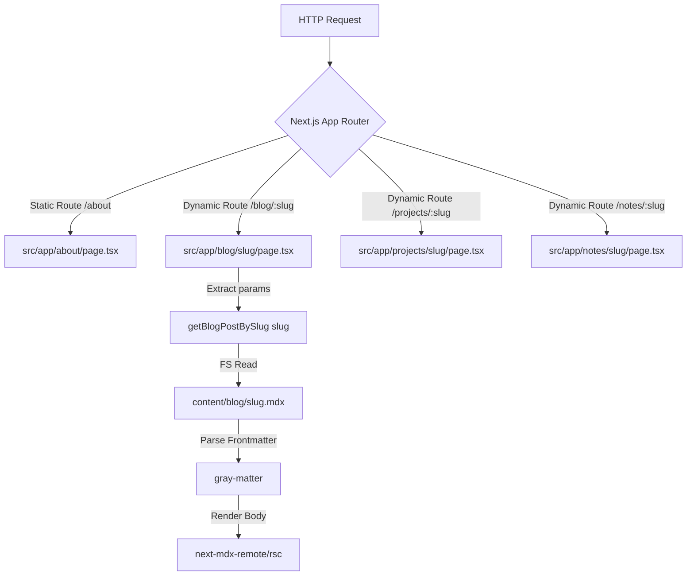
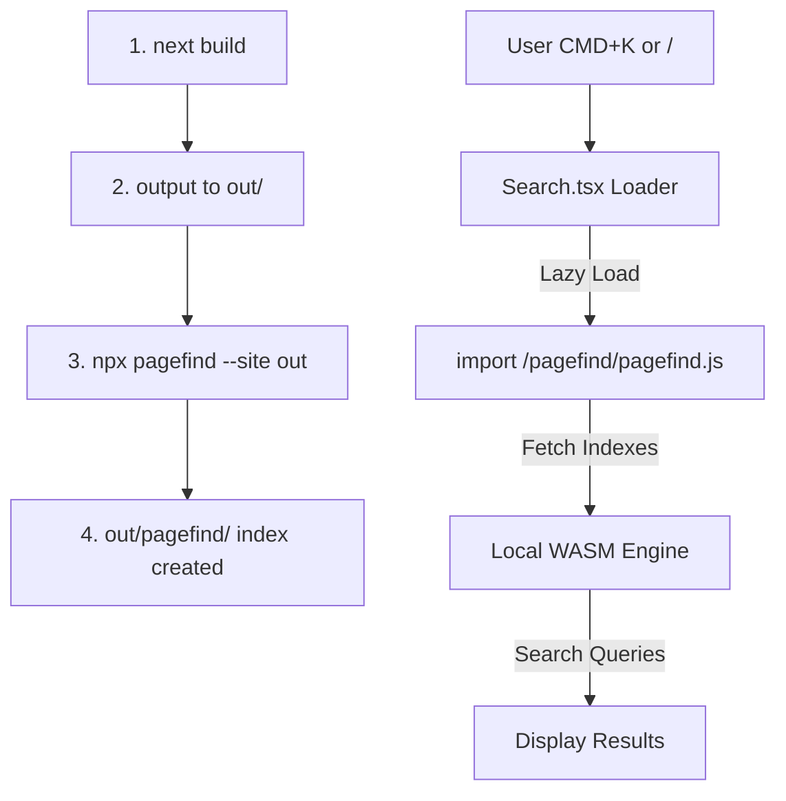
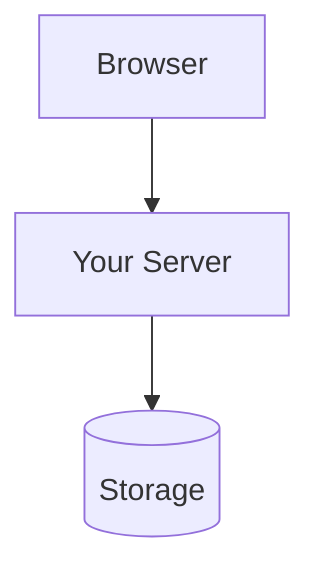

# imagitech.online — Operations and Content Manual

Welcome to the operations manual and developer handbook for [imagitech.online](https://imagitech.online).

This project functions as a high-density technical notebook, professional engineering portfolio, and documentation portal. It houses architectural diagrams, systems engineering guides, networking configurations, penetration testing references, and post-mortems. The system is designed for maximum reading density, speed, accessibility, and zero-javascript-overhead content loading where possible.

---

## 1. System Architecture

The site is built as a statically exported [Next.js](https://nextjs.org/) application leveraging React, TypeScript, Tailwind CSS v4, and dynamic MDX processing. It features keyboard-navigable client-side search via [Pagefind](https://pagefind.app/) and uses a custom Clay-Copper design system.

### 1.1 Directory Tree

Below is the directory structure layout, showing where configuration, code, and content are separated:

```text
imagitech-online/
├── .github/
│   └── workflows/
│       └── cloudflare-pages.yml  # CI/CD deployment pipeline to Cloudflare Pages
├── content/                      # MDX Content Repository (separated by type)
│   ├── blog/                     # Long-form engineering articles and logs
│   │   ├── self-hosted-vpn-guide.mdx
│   │   └── self-hosting-wireguard.mdx
│   ├── notes/                    # High-density code cheatsheets and command lists
│   │   ├── linux-networking.mdx
│   │   ├── penetration-testing-tools.mdx
│   │   └── tmux.mdx
│   └── projects/                 # Production infrastructure case studies
│       ├── autoscript-pro.mdx
│       └── filestation.mdx
├── public/                       # Static assets served at the root (favicons, feeds)
│   └── feed.xml                  # Auto-generated RSS feed
├── scripts/
│   └── test-server.js            # Local static file server for E2E test runs
├── src/
│   ├── app/                      # App Router static pages and layout configurations
│   │   ├── about/                # Static "About" page
│   │   ├── blog/                 # Blog list and dynamic [slug] post renderer
│   │   ├── contact/              # Contact information page
│   │   ├── notes/                # Notes indexing and rendering sub-routes
│   │   ├── now/                  # Status log ("Now" page)
│   │   ├── projects/             # Project showcase routes
│   │   ├── uses/                 # Hardware/software tooling index ("Uses")
│   │   ├── globals.css           # Design system variables, animations, scrollbars
│   │   ├── layout.tsx            # Global RootLayout, font loading, HTML shell
│   │   ├── page.tsx              # Main dashboard landing page
│   │   ├── robots.ts             # Dynamic robots.txt generation
│   │   └── sitemap.ts            # Dynamic sitemap.xml generation
│   ├── components/               # Reusable React components
│   │   ├── Callout.tsx           # Styled markdown notice containers (tip/warning/etc.)
│   │   ├── CodeBlock.tsx         # Copyable syntax-highlighted code block with copy button
│   │   ├── Footer.tsx            # Footer with uptime indicator and copyright
│   │   ├── Header.tsx            # Sticky navigation header with mobile overlay menu
│   │   ├── Mdx.tsx               # Core MDX renderer mapping HTML tags to custom components
│   │   ├── Mermaid.tsx           # Client-side renderer for flowcharts and diagrams
│   │   ├── NotesClient.tsx       # Client-side notes filtering and search component
│   │   ├── Search.tsx            # Keyboard-navigable search portal overlay (React Portal)
│   │   └── TableOfContents.tsx   # Dynamic side-menu outlining headings
│   ├── lib/                      # Technical helper libraries and scripts
│   │   ├── mdx.ts                # File system parser, slug resolver, and TOC extractor
│   │   └── rss.ts                # Automated RSS XML compilation generator
│   └── types/
│       └── index.ts              # TypeScript definitions for articles, projects, and notes
├── tests/
│   └── e2e/
│       └── site.spec.ts          # Playwright end-to-end test suite
├── next.config.ts                # Next.js compiler settings (static export, unoptimized images)
├── playwright.config.ts          # Playwright configuration for E2E testing
├── server.js                     # Node.js production server for local previews and MIME mapping
├── tsconfig.json                 # TypeScript configuration
└── package.json                  # Project dependencies, scripts, and build tasks
```

### 1.2 Routing Logic



*   **App Router Static Routes**: Simple static routes are defined directly as page folders in `src/app/`. These include directories like `about/`, `contact/`, `now/`, and `uses/`.
*   **Dynamic MDX Routes**: Dynamic folders (`blog/[slug]`, `projects/[slug]`, `notes/[slug]`) catch path requests and parse corresponding files from `content/`. During compile time, `generateStaticParams()` pre-renders every MDX file as a standalone static HTML file.
*   **Zero Server-Side Dependency**: Because `next.config.ts` enforces `output: "export"`, routing does not rely on a Node.js server. Instead, routes map directly to physical HTML files on the filesystem (e.g., `/blog/my-post` matches `/blog/my-post.html`).

### 1.3 The MDX Processing System

All content in `content/` is parsed and compiled using a modular processing engine in [Mdx.tsx](file:///home/dreamer/imagitech-online/src/components/Mdx.tsx):

1.  **Metadata Extraction**: [mdx.ts](file:///home/dreamer/imagitech-online/src/lib/mdx.ts) reads files via Node's `fs` module, using **gray-matter** to separate frontmatter key-value pairs (like `title`, `date`, `tags`) from the main body.
2.  **Compilation**: The compiler uses `MDXRemote` from **next-mdx-remote/rsc** to transform markdown content into dynamic React nodes.
3.  **AST Transformation Plugins**:
    *   `remark-gfm`: Injects support for GitHub Flavored Markdown (tables, checkboxes, strikethroughs, raw links).
    *   `remarkMermaid` (Custom Plugin): An AST-walker that detects code blocks with the `mermaid` language identifier and converts them to `<Mermaid chart="..." />` JSX elements.
    *   `rehype-slug`: Generates unique kebab-case IDs from heading text for page-level section anchoring.
    *   `rehype-autolink-headings`: Wraps headings in anchor links pointing to their generated IDs with a `#` symbol on hover.
    *   `rehype-pretty-code` & **Shiki**: Syntax highlighting with a custom Clay-Copper theme. Handles line highlights (e.g. `{3-5}`) and code block titles.
4.  **Tag-to-Component Mapping**: HTML tags inside MDX are mapped to custom styled React components:
    *   `a` — handles internal Next.js transitions or enforces `target="_blank"` for external links.
    *   `pre` — maps to [CodeBlock.tsx](file:///home/dreamer/imagitech-online/src/components/CodeBlock.tsx), wrapping Shiki output with code titles, language tags, and a clipboard copy button.
    *   `Callout` and `Mermaid` — registered globally in the MDX component context.

### 1.4 Component Layout Boundaries

*   **HTML Outer Boundary**: Managed in [layout.tsx](file:///home/dreamer/imagitech-online/src/app/layout.tsx), which loads the Geist web fonts and structures the skip-to-content accessibility link.
*   **Sticky Navbar**: Managed by [Header.tsx](file:///home/dreamer/imagitech-online/src/components/Header.tsx). Includes nav links, mobile menu overlay with focus trap, and search trigger.
*   **Search Overlay**: Defined in [Search.tsx](file:///home/dreamer/imagitech-online/src/components/Search.tsx). Uses a **React Portal** that mounts directly at `document.body` to prevent parent flex constraints from cropping the modal.
*   **Footer**: Configured in [Footer.tsx](file:///home/dreamer/imagitech-online/src/components/Footer.tsx), which renders copyright metadata, automated year calculation, and a pulse dot status indicator.

### 1.5 Static Export & Pagefind Search Indexing



1.  **Compilation Output**: The Next.js pipeline outputs statically generated files to the `out/` directory.
2.  **Indexing Pipeline**: Post-compilation, `npx pagefind --site out` crawls all HTML in `out/`, builds custom indices, and generates WebAssembly search binaries under `out/pagefind/`.
3.  **Lazy Loading Strategy**: Search resources are not loaded on page load. When a user presses `CMD+K`, `CTRL+K`, or `/`, [Search.tsx](file:///home/dreamer/imagitech-online/src/components/Search.tsx) dynamically imports `/pagefind/pagefind.js`.
4.  **Local Execution**: The search engine runs on the user's browser thread via WebAssembly — no server roundtrip.
5.  **MIME Type Constraint**: The web server must serve `.wasm` assets with `Content-Type: application/wasm`. Without this, browsers block WebAssembly compilation and search is disabled.

---

## 2. Local Setup and Development

Follow these steps to run, build, and maintain the codebase.

### 2.1 Dependencies Installation

The project requires **Node.js v18.0.0 or higher** and uses npm.

```bash
# Clone the repository and navigate to the directory
cd /home/dreamer/imagitech-online

# Perform clean dependency installation using the lockfile
npm ci
```

### 2.2 Running Development Server

```bash
npm run dev
```

The site will be active at [http://localhost:3000](http://localhost:3000).

> [!NOTE]
> During local development, the search overlay displays mock placeholder results because the Pagefind search indexes are compiled post-build and are not refreshed dynamically in dev mode.

### 2.3 Production Compilation

Build the website and generate the search indexes:

```bash
npm run build
```

This script:
1. Compiles the Next.js code.
2. Exports raw static files to the `out/` folder.
3. Automatically triggers RSS feed compilation.
4. Crawls the `out/` directory with Pagefind to build the WebAssembly search index.

### 2.4 Code Verification (Linting & Typechecking)

Ensure all files pass standard rules before committing changes:

```bash
# Run ESLint validation checks
npm run lint

# Run TypeScript compiler verification (strict typecheck)
npx tsc --noEmit
```

### 2.5 End-to-End (E2E) Testing

```bash
# 1. Build the application first
npm run build

# 2. Start the local preview server (configured in scripts/test-server.js)
node scripts/test-server.js

# 3. In a separate terminal, run the Playwright E2E tests
npx playwright test
```

---

## 3. Writing and Formatting Content

Content is organized in the `content/` folder. The system parses and renders MDX files according to their frontmatter metadata and location.

| Content Type | Storage Directory | Primary Purpose | Key Fields |
| :--- | :--- | :--- | :--- |
| **Blog Posts** | `content/blog/` | Long-form technical logs, post-mortems, system guides | `title`, `description`, `date`, `published`, `tags` |
| **Projects** | `content/projects/` | Structural project specs, case studies, open-source work | `title`, `description`, `github`, `url`, `technologies`, `featured` |
| **Notes** | `content/notes/` | High-density cheatsheets, CLI references, command lists | `title`, `date`, `category`, `published` |

### 3.1 Writing a New Blog Post

Create your post at `content/blog/your-post-slug.mdx`. The filename must match the URL slug exactly.

#### Required Frontmatter Fields

*   `title` (string): The title of your post.
*   `description` (string): A short summary for the feed and SEO meta tags.
*   `date` (string): Publication date formatted as `YYYY-MM-DD`.
*   `published` (boolean): Set to `false` to save as a draft.
*   `tags` (array of strings): Technical categories for metadata.

#### Blog Post Template

```markdown
---
title: "Your Post Title Here"
description: "A short one-sentence summary of what this post covers."
date: "2026-07-17"
published: true
tags: ["Linux", "Networking", "VPN"]
---

Opening paragraph explaining the problem or context.

## Section Heading

Your content here. Use code blocks with language identifiers:

```bash
# Example bash command
sudo systemctl status nginx
```

Use `<Callout>` components for important notices:

<Callout type="warning" title="Important">
Your warning message here.
</Callout>
```

### 3.2 Writing a New Project Case Study

Projects are placed under `content/projects/your-project-slug.mdx`.

#### Required Frontmatter Fields

*   `title` (string): Project name.
*   `description` (string): Short overview of the project's purpose.
*   `date` (string): Project release date (`YYYY-MM-DD`).
*   `github` (string): URL to the GitHub repository.
*   `url` (string, optional): Live demo URL.
*   `technologies` (array of strings): Technologies used.
*   `featured` (boolean): Set to `true` to showcase on the home page dashboard.
*   `published` (boolean): Set to `true` to publish.

#### Project Template

```markdown
---
title: "Your Project Name"
description: "One sentence describing what this project does."
date: "2026-07-17"
github: "https://github.com/DDreamer01/your-repo"
url: "https://project.imagitech.online"
technologies: ["Python", "Bash", "Linux", "Nginx"]
featured: true
published: true
---

## Overview

What the project is and why it exists.

## Problem

What problem it solves.

## Architecture



## Features

- Feature one
- Feature two

## Usage

```bash
# How to install or run it
./install.sh
```
```

### 3.3 Writing a New Technical Note

Notes are short-form developer cheatsheets, command logs, or diagnostic references stored in `content/notes/your-note-slug.mdx`.

Unlike blog posts, notes do not require narrative summaries — they focus on providing reference commands and configurations.

#### Required Frontmatter Fields

*   `title` (string): Cheatsheet title.
*   `date` (string): Last update date (`YYYY-MM-DD`).
*   `category` (string): One of `Linux`, `Cybersecurity`, `Docker`, `Networking`, `Git`, etc.
*   `published` (boolean): Set to `true` to publish.

#### Note Template

```markdown
---
title: "Your Note Title"
date: "2026-07-17"
category: "Linux"
published: true
---

Brief one-line description of what this note covers.

---

## 1. Section Title

Context sentence explaining what the commands below do:

```bash
# Annotated command with explanation
sudo command --flag value
```

## 2. Next Section

For keyboard shortcuts, use `<kbd>` tags:

Press <kbd>Ctrl</kbd> + <kbd>b</kbd>, then <kbd>d</kbd> to detach.
```

### 3.4 Current Content Index

#### Blog Posts (`content/blog/`)
| File | Title |
| :--- | :--- |
| `self-hosted-vpn-guide.mdx` | Building a Stealth VPN Gateway: VLESS Reality & SNI Multiplexing |
| `self-hosting-wireguard.mdx` | Self-Hosting a VPN Server on AlmaLinux |

#### Projects (`content/projects/`)
| File | Title | Featured |
| :--- | :--- | :--- |
| `autoscript-pro.mdx` | Imagitech Autoscript Pro | ✅ |
| `filestation.mdx` | FileStation | ✅ |

#### Notes (`content/notes/`)
| File | Title | Category |
| :--- | :--- | :--- |
| `linux-networking.mdx` | Useful Linux Networking Commands | Linux |
| `penetration-testing-tools.mdx` | Tools I Use for Pentesting | Cybersecurity |
| `tmux.mdx` | Useful tmux Commands | Linux |

### 3.5 Writing Guidelines

*   **Experience-Driven Content**: Document actual engineering problems, real configuration settings, and verified CLI outputs. Avoid generic tutorials.
*   **Technical Accuracy**: Verify commands, configurations, and scripts locally before publishing.
*   **Conciseness and Clarity**: Get straight to the point. Use Mermaid diagrams for complex architectures.
*   **No AI Filler**: Avoid generic introductions or AI-generated transition phrases. Keep content technical, detailed, and in your own words.
*   **Document Failure Modes**: Include the errors you encountered, how you diagnosed them, and the steps taken to resolve them.
*   **Keyboard Shortcuts**: Use `<kbd>` HTML tags for key combinations (e.g., `<kbd>Ctrl</kbd> + <kbd>b</kbd>`).

---

## 4. Deployment

The website is self-hosted on an Azure Linux VM. Cloudflare manages the domain (`imagitech.online`) for DNS resolution only — the grey cloud (DNS-only, no Cloudflare proxy or CDN). There is no CI/CD pipeline; deployment is a manual `git pull` on the server.

### 4.1 Infrastructure Overview

```text
Local Machine ──git push──▶ GitHub (public repo, SSH key auth)
                                      │
                                      ▼ (manual: ssh into server → git pull)
                         Azure Linux VM (self-hosted)
                                      │
                              Nginx reverse proxy
                                      │
                              Next.js static output (out/)
                                      │
                         imagitech.online ◀── Cloudflare
```

- **Domain**: `imagitech.online` — registered and DNS-managed via Cloudflare (grey cloud = DNS resolution only, no Cloudflare proxy).
- **Hosting**: Azure Linux VM running Nginx to serve the static `out/` directory.
- **Version Control**: Public GitHub repository, authenticated locally via SSH keys. No deploy tokens required.

### 4.2 First-Time Server Setup

On a fresh Azure Linux VM:

```bash
# Install Node.js (via NodeSource for a current version)
curl -fsSL https://deb.nodesource.com/setup_20.x | sudo -E bash -
sudo apt-get install -y nodejs

# Install Nginx
sudo apt-get install -y nginx

# Clone the repository (public repo — no auth needed)
git clone git@github.com:DDreamer01/imagitech-online.git /var/www/imagitech-online
cd /var/www/imagitech-online

# Install dependencies and build
npm ci
npm run build
# The static site is now in out/
```

Configure Nginx to serve the `out/` directory (see Section 4.3).

### 4.3 Nginx Configuration

Create a config file at `/etc/nginx/sites-available/imagitech.online`:

```nginx
server {
    listen 80;
    server_name imagitech.online www.imagitech.online;

    root /var/www/imagitech-online/out;
    index index.html;

    # Serve static files; fall back to index.html for client-side routing
    location / {
        try_files $uri $uri.html $uri/ =404;
    }

    # Required: serve .wasm files with the correct MIME type for Pagefind search
    location ~* \.wasm$ {
        types { application/wasm wasm; }
    }

    # Cache static assets aggressively
    location ~* \.(js|css|png|jpg|jpeg|gif|ico|svg|woff2)$ {
        expires 1y;
        add_header Cache-Control "public, immutable";
    }
}
```

Enable the site and reload Nginx:

```bash
sudo ln -s /etc/nginx/sites-available/imagitech.online /etc/nginx/sites-enabled/
sudo nginx -t
sudo systemctl reload nginx
```

> [!NOTE]
> To add HTTPS, use Certbot: `sudo apt install certbot python3-certbot-nginx && sudo certbot --nginx -d imagitech.online`. Since Cloudflare is grey cloud (DNS-only), you can obtain a certificate directly from Let's Encrypt.

### 4.4 Deploying Updates

The standard update workflow after pushing changes from your local machine:

```bash
# On your local machine — commit and push as usual
git add -A
git commit -m "add: new blog post on XYZ"
git push origin main

# SSH into the Azure server
ssh user@your-azure-server-ip

# Pull the latest changes and rebuild
cd /var/www/imagitech-online
git pull origin main
npm ci          # only needed if package.json changed
npm run build   # rebuilds the static output into out/
```

Nginx serves from the `out/` directory directly — no server restart needed after a build.


### 4.5 Rollbacks

If a bad build is deployed:

```bash
# On the server — revert to the previous commit and rebuild
cd /var/www/imagitech-online
git log --oneline -5        # find the last good commit hash
git checkout <commit-hash>  # check out that version
npm run build               # rebuild from that version
```

To fix properly in the repository (from your local machine):

```bash
git revert HEAD
git push origin main
# Then pull and rebuild on the server as usual
```


---


## 5. Maintenance and Code Preservation

### 5.1 CSS Custom Properties Protection

All colors are controlled by CSS variables in [globals.css](file:///home/dreamer/imagitech-online/src/app/globals.css). Do not replace these with hardcoded Tailwind color utilities.

```css
/* Core theme tokens — do not replace with raw Tailwind utilities */
--background: #181818;
--foreground: #F2F2F2;
--card: #222222;
--border: #353535;
--primary: #CF7253; /* Primary Accent: Clay */
```

> [!WARNING]
> The site remaps Tailwind's built-in `sky-*` and `slate-*` colors to match the Clay-Copper theme. When you see `text-sky-400` in JSX it renders as clay orange (`#CF7253`), **not** blue. Do not add standard Tailwind color classes expecting their default colors.

Use semantic class wrappers (`bg-card`, `border-border`, `text-primary`) to ensure color consistency.

### 5.2 Layout Integrity

*   Do not add custom margins inside page templates that break the global max-width wrapper (`max-w-5xl px-4 sm:px-6 lg:px-8`).
*   Ensure all page components are responsive and adapt to mobile layouts.
*   When editing the header or footer, test the layout locally to prevent heading occlusion issues (`scroll-margin-top: 5.5rem` prevents heading elements from being hidden behind the sticky header).

### 5.3 Zero-Regression Verification Checklist

Before committing any layout changes, script edits, or dependency updates:

```bash
# 1. Clean build artifacts
rm -rf .next out

# 2. Run strict TypeScript type checking
npx tsc --noEmit

# 3. Run ESLint
npm run lint

# 4. Full production build + search index
npm run build
```
