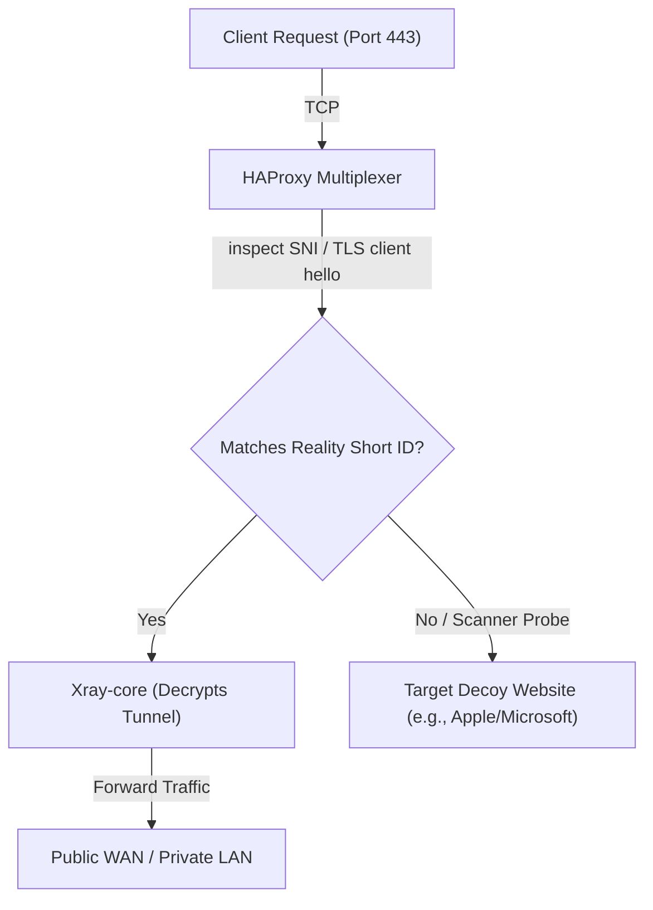

Traditional VPN protocols (like OpenVPN or WireGuard) operate over distinct ports with easily identifiable packet headers. In highly restricted networks, firewalls use Deep Packet Inspection (DPI) to quickly identify and block these signatures. 

To overcome this, modern systems use **stealth proxies**. In this guide, we walk through manually building a stealth VPN gateway from scratch using **Xray-core**, **VLESS Reality**, and **HAProxy** port multiplexing—the exact architecture powering enterprise VPN scripts.

---

## 1. How Stealth Camouflage Works

VLESS Reality solves the handshake identification problem by **hijacking TLS client handshakes**. 

When a client connects to your server on port 443, the handshake is redirected. If the client has a pre-shared Reality credential, the connection is authenticated as a VPN tunnel. If a scanning probe or firewall connects without credentials, the server seamlessly proxies a legitimate third-party website (such as `www.microsoft.com` or `www.apple.com`), returning valid certificates and completely hiding the VPN server's identity.



---

## 2. Step 1: Installing Xray-core

To install the proxy engine, fetch the latest stable release binaries from the official repository, extract the package, and set up the binary path:

```bash
# Set variables
PLATFORM="linux-64"
LATEST_VERSION=$(curl -s https://api.github.com/repos/XTLS/Xray-core/releases/latest | grep tag_name | cut -d '"' -f 4)

# Download and extract Xray-core
wget -qO- "https://github.com/XTLS/Xray-core/releases/download/${LATEST_VERSION}/Xray-${PLATFORM}.zip" > /tmp/xray.zip
sudo unzip -q /tmp/xray.zip -d /opt/xray/
sudo ln -sf /opt/xray/xray /usr/local/bin/xray
```

---

## 3. Step 2: Generating Cryptographic Credentials

VLESS Reality relies on three critical secrets: a client UUID, a custom private/public X25519 key pair, and a short hex ID.

### A. Generate Client UUID
The client ID must be a valid UUIDv4 string. Generate it using the built-in Xray utility:

```bash
xray uuid
# Example Output: 8a6f3b0e-d7f4-41d3-98fe-bcde12345678
```

### B. Generate X25519 Key Pair
The server and client encrypt the initial handshake using Curve25519 cryptography. Generate your private and public key pair using:

```bash
xray x25519
# Example Output:
# Private key: uKB8jQ...your_private_key...
# Public key:  Fz3P9x...your_public_key...
```
* **Private Key**: Retained strictly on the server config.
* **Public Key**: Shared with clients in the import URI config.

### C. Generate Short ID
A short ID is a hex string (between 2 to 16 characters) used to validate TLS sessions. Generate a random one:

```bash
openssl rand -hex 8
# Example Output: 0a1b2c3d4e5f6a7b
```

---

## 4. Step 3: Configuring the VLESS Reality Inbound

Create the primary configuration file for Xray-core at `/opt/xray/config.json`. This block sets up VLESS over TCP using the XTLS Vision flow for stealth camouflage:

```json
{
  "log": {
    "loglevel": "warning"
  },
  "inbounds": [
    {
      "port": 10000,
      "listen": "127.0.0.1",
      "protocol": "vless",
      "settings": {
        "clients": [
          {
            "id": "8a6f3b0e-d7f4-41d3-98fe-bcde12345678",
            "flow": "xtls-rprx-vision"
          }
        ],
        "decryption": "none"
      },
      "streamSettings": {
        "network": "tcp",
        "security": "reality",
        "realitySettings": {
          "show": false,
          "dest": "www.microsoft.com:443",
          "xver": 0,
          "serverNames": [
            "www.microsoft.com",
            "microsoft.com"
          ],
          "privateKey": "uKB8jQ...your_private_key...",
          "shortIds": [
            "0a1b2c3d4e5f6a7b"
          ]
        }
      }
    }
  ],
  "outbounds": [
    {
      "protocol": "freedom"
    }
  ]
}
```

---

## 5. Step 4: Setting up HAProxy SNI Routing

Instead of listening directly on port 443, we configure **HAProxy** as our frontend load balancer. HAProxy inspects the TLS Server Name Indication (SNI) header without decrypting the payload, routing normal SSH traffic to Dropbear, and VPN traffic to Xray.

Install HAProxy:

```bash
sudo apt update && sudo apt install haproxy -y
```

Append the following configuration to `/etc/haproxy/haproxy.cfg`:

```haproxy
frontend main_https
    bind 0.0.0.0:443
    mode tcp
    tcp-request inspect-delay 5s
    tcp-request content accept if { req_ssl_hello_type 1 }

    # Route TLS traffic matching our SNI domains to Xray VLESS Reality
    use_backend xray_backend if { req_ssl_sni -i www.microsoft.com }
    use_backend xray_backend if { req_ssl_sni -i microsoft.com }

    # Default fallback backend (e.g. Dropbear SSH tunnel on port 22)
    default_backend ssh_backend

backend xray_backend
    mode tcp
    server xray_srv 127.0.0.1:10000 check

backend ssh_backend
    mode tcp
    server ssh_srv 127.0.0.1:22 check
```

---

## 6. Step 5: Process Control via Systemd

To keep Xray running automatically in the background, create a systemd service unit file at `/etc/systemd/system/xray.service`:

```ini
[Unit]
Description=Xray Core Proxy Server
Documentation=https://github.com/XTLS/Xray-core
After=network.target nss-lookup.target

[Service]
User=root
CapabilityBoundingSet=CAP_NET_ADMIN CAP_NET_BIND_SERVICE
AmbientCapabilities=CAP_NET_ADMIN CAP_NET_BIND_SERVICE
NoNewPrivileges=true
ExecStart=/usr/local/bin/xray run -config /opt/xray/config.json
Restart=on-failure
RestartPreventExitStatus=23
LimitNPROC=10000
LimitNOFILE=1000000

[Install]
WantedBy=multi-user.target
```

Enable and start the services:

```bash
sudo systemctl daemon-reload
sudo systemctl enable --now xray haproxy
```

---

## 7. Client Connection Format

Once your server is running, the client connection string (in importable URI format) is generated as follows:

```txt
vless://8a6f3b0e-d7f4-41d3-98fe-bcde12345678@your_server_ip:443?security=reality&sni=www.microsoft.com&pbk=YOUR_PUBLIC_KEY&sid=0a1b2c3d4e5f6a7b&flow=xtls-rprx-vision#Stealth-VLESS
```

By separating the routing logic into HAProxy and using the `xray x25519` command to secure handshakes, this architecture prevents scanning probes from identifying your server, establishing a robust and censorship-resistant VPN gateway.
