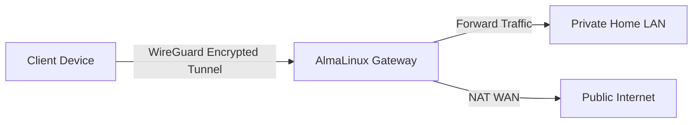

Setting up a VPN server is essential for securing remote access to home servers and private networks. In this post, I document how I self-host a WireGuard VPN server inside a Docker container on AlmaLinux 9, with automated configuration and routing.

## Why WireGuard?

WireGuard is an extremely simple yet fast and modern VPN that utilizes state-of-the-art cryptography. Compared to OpenVPN, it is much lighter, runs in kernel space, and connects almost instantly.

Here is the general architecture:



## Docker Compose Setup

I run WireGuard via the excellent linuxserver image, which makes setup a breeze.

```yaml
services:
  wireguard:
    image: lscr.io/linuxserver/wireguard:latest
    container_name: wireguard
    cap_add:
      - NET_ADMIN
      - SYS_MODULE
    environment:
      - PUID=1000
      - PGID=1000
      - TZ=Etc/UTC
      - SERVERURL=vpn.imagitech.online
      - SERVERPORT=51820
      - PEERS=laptop,phone,tablet
      - PEERDNS=1.1.1.1
      - INTERNAL_SUBNET=10.13.13.0
    ports:
      - 51820:51820/udp
    volumes:
      - ./config:/config
      - /lib/modules:/lib/modules
    sysctls:
      - net.ipv4.conf.all.src_valid_mark=1
    restart: unless-stopped
```

### Scripted Configuration

To enable network address translation (NAT) and forward traffic correctly, we must configure IPv4 packet forwarding on the host system:

```bash
# Enable IPv4 forwarding temporarily
sudo sysctl -w net.ipv4.ip_forward=1

# Make it permanent
echo "net.ipv4.ip_forward=1" | sudo tee -a /etc/sysctl.d/99-sysctl.conf
sudo sysctl --system
```

<Callout type="warning" title="Security Notice">
Ensure your firewall (firewalld or UFW) allows UDP traffic on port 51820, and enables masquerading on your external network interface to prevent leakages.
</Callout>
