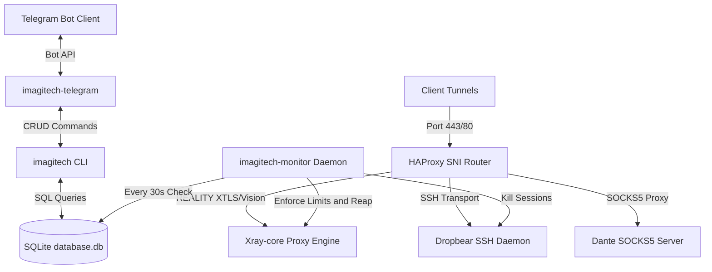

## Overview

**Imagitech Autoscript Pro** is an enterprise-grade VPS orchestration engine designed to provision and manage secure multi-protocol proxy environments. Operating from a single-command installer, it deploys a robust, sandboxed suite of services featuring real-time bandwidth accounting, active multi-login prevention, automated ghost process reaping, encrypted backups, and remote Telegram Bot management.

## Problem

Building private network infrastructure across modern cloud environments presents several operational challenges:
1. **Multi-Protocol Complexity**: Deploying SSH, VLESS Reality, Trojan, and SOCKS5 services separately leads to port conflicts, certificate mismatches, and fragmented configuration.
2. **Resource Exhaustion**: VPS instances are prone to bandwidth overflow and resource hoarding due to zombie tunnels, unauthorized multi-device sharing, and expired user accounts.
3. **No Headless Control**: Administrators must constantly log into SSH terminal sessions to run root scripts whenever they need to create, query, renew, or remove accounts.

## Architecture

Autoscript Pro manages network transport using **HAProxy** as a high-performance frontend load-balancer and SNI router. Incoming traffic on port 443 is multiplexed and redirected internally based on TLS SNI fields and protocol signatures.



## Features

### 🔌 Multi-Protocol Tunneling
Autoscript Pro configures a comprehensive list of ingress proxy paths:
- **VLESS Reality (xHTTP/Vision)**: Custom transport with XTLS Vision flow for zero-overhead, camouflage encryption.
- **WebSocket Tunnels (TLS & Non-TLS)**: Path-routed VMess, VLESS, and Trojan WebSocket proxies for CDN/Cloudflare bypass.
- **Dropbear & OpenSSH**: Dual SSH entrypoints on specialized port ranges.
- **DNSTT (SlowDNS)**: Encapsulated DNS tunneling for escaping heavily restricted networks.
- **UDP Custom**: Direct kernel-optimized UDP transport for gaming and VoIP protocols.

### 🛡️ Active Monitoring & Enforcement
The system includes a Python background daemon (`daemon.py`) that runs as a systemd service (`imagitech-monitor`). Every 30 seconds, it:
1. **Prevents Multi-Logins**: Disconnects accounts exceeding their allowed concurrent device quota.
2. **Bandwidth Accounting**: Gathers Xray stats (via gRPC) and OS statistics (via `/proc/io`) to enforce per-user GB limits.
3. **Ghost Account Reaper**: Automatically terminates expired subscriptions, removes Linux accounts, and logs activities cleanly.

### 🤖 Telegram Bot Controller
Administrators can completely control their server remotely via Telegram:
- **One-Click User CRUD**: Create, extend, or delete users using inline keyboards.
- **Free Trial System**: Automated generation of time-limited free trial connections.
- **Service & Host Config**: Dynamically switch host domain, NS records, and TLS SNI configurations, or restart systemd units on the fly.

## System Layout

To maintain host OS clean-states, the entire environment is sandboxed under `/opt/imagitech/`:

```
/opt/imagitech/
├── bin/
│   └── imagitech              # Headless CLI API router
├── core/
│   ├── database.db            # SQLite3 database (schemas shown below)
│   ├── imagitech.conf         # Global settings config
│   ├── telegram.conf          # Bot Token & Chat ID definitions
│   └── keys/                  # Reality/SlowDNS SSL cryptography keys
├── lib/
│   └── *.sh                   # Modular installer & database helper functions
└── services/
    ├── monitor/
    │   ├── daemon.py          # Python session monitor daemon
    │   └── telegram-controller.py # Telegram API event engine
    └── routing/
        └── ws-proxy.py        # Async WebSocket HTTP injector
```

### SQLite3 Schema Reference (`database.db`)

| Column Name | Data Type | Default / Constraints | Purpose |
|-------------|-----------|-----------------------|---------|
| `id` | INTEGER | PRIMARY KEY AUTOINCREMENT | Unique record ID |
| `username` | TEXT | UNIQUE NOT NULL | Unique account name (Linux PAM user) |
| `uuid` | TEXT | NULL | Xray core UUID identifier |
| `protocols` | TEXT | `'ssh,ws,socks'` | Allowed protocols |
| `account_type` | TEXT | `'SSH'` | Classification (`SSH` or `XRAY`) |
| `expiry_date` | TEXT | NOT NULL | Expiration timestamp (YYYY-MM-DD HH:MM:SS) |
| `max_logins` | INTEGER | `2` | Allowed concurrent logins |
| `bandwidth_limit_mb` | INTEGER | `0` | Bandwidth limit in MB (legacy) |
| `bandwidth_used_mb` | INTEGER | `0` | Bandwidth used in MB (legacy) |
| `status` | TEXT | `'ACTIVE'` | Account status (`ACTIVE`, `LOCKED`, `EXPIRED`) |
| `created_at` | DATETIME | `CURRENT_TIMESTAMP` | Account creation timestamp |
| `data_usage` | BIGINT | `0` | Real-time byte usage (Upload + Download) |
| `data_limit` | BIGINT | `0` | Bandwidth quota in bytes (0 = unlimited) |

## Installation & CLI Usage

Install the orchestrator on a fresh **Ubuntu** or **Debian** LTS server running as `root`:

```bash
bash <(curl -sL https://vpn.imagitech.online/install.sh)
```

Once installed, use the interactive terminal UI by typing `menu`, or automate configurations headlessly using the command-line utility:

```bash
# Register a new XRAY subscriber with a 50GB limit for 30 days
imagitech user add subscriber_name secret_password 30 2 50 XRAY

# Generate a 6-hour trial SSH connection
imagitech user trial tester_name trial_password 6 1 5 SSH

# Push database & settings state to an encrypted AES-256-CBC backup
imagitech sys backup
```
