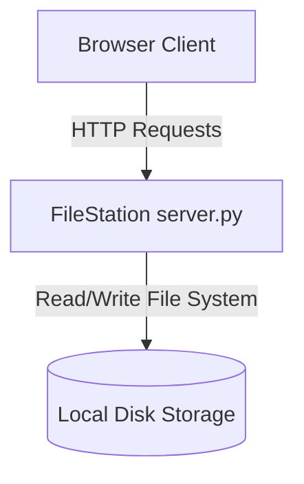

## Overview

FileStation is an ultra-lightweight, single-file Python web server that transforms any server directory into a modern, secure web interface for file storage and management. 

## Problem

When managing remote Linux systems, traditional tools like FTP are tedious to configure and require specialized clients, while heavy services like Nextcloud are overkill and resource-intensive for simple storage nodes. I needed a tool that was:
1. Instantly deployable (zero external python dependencies).
2. Capable of handling huge files (5GB+ ISOs) over unstable connections.
3. Accessible via a standard web browser on mobile or desktop.

## Architecture

FileStation is contained in a single `server.py` file to make deployment trivial. The backend uses Python's standard `http.server` library running on multi-threaded sockets.



## Features

- **Single-File Architecture**: Drop `server.py` anywhere and execute.
- **Resumable Chunked Uploads**: Re-upload files after network failures without losing progress.
- **Folder Drag-and-Drop**: Recursively reads directory trees using browser APIs.
- **Let's Encrypt SSL Integration**: Handles HTTPS redirects and automated certificate renewals natively.

## Installation & Usage

Run the automated installer:

```bash
chmod +x install.sh
sudo ./install.sh
```

Or start the server manually using Python 3:

```bash
python3 server.py -d /home/user/files -u admin --password secret
```
