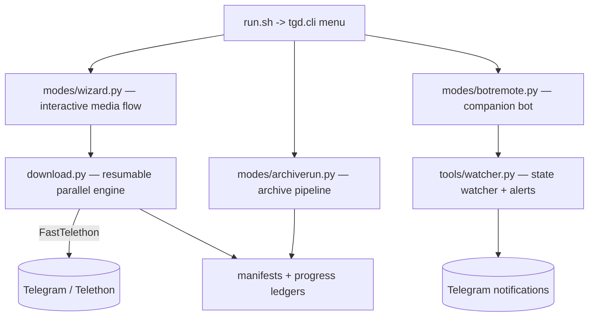

## Overview

TG Downloader (Resilient Edition, v2) is a consolidated Python package that turns Telegram channels into reliable, resumable file sources. It ships as a interactive terminal wizard, a space-aware archive pipeline, and a Telegram companion bot — all driven by a single `./run.sh` entry point.

## Problem

Telegram is an excellent free file host, but its clients make a terrible bulk-download experience:

1. **No resumable semantics across restarts** — an interrupted 4 GB file starts from zero.
2. **FloodWait throttling** kills naive sequential scripts mid-batch.
3. **Multipart archive sets** (`.part`/password-protected/multi-volume) arrive fragmented and unvalidated.
4. **Running out of disk at 85%** of a 100-file batch is the default failure mode.

I needed a tool that treats large downloads as an engineering pipeline with honest state, not a one-shot script.

## Architecture

The layout is a single Python package (`tgd/`) with strict module boundaries — the CLI menu is the only entry point, and every state file (`state.json`, `control.json`, `progress*.json`) lives under `configs.py` as the single source of truth.



## Key Features

- **Resumable parallel engine**: `.part` files resume across restarts with FloodWait-aware retries; live disk guards (pre-flight and in-flight) prevent partial-write disasters.
- **Interactive wizard**: channel-picking, filtering, and batch flows without CLI-flag archaeology.
- **Archive pipeline**: disk pre-flight guard, password hunter, duplicate-set pairing for multipart archives with deep CRC validation, and per-item `pipeline.log` with honest manifest (`archive_manifest.{md,csv}`) — nothing is processed without a terminal state.
- **Console hotkeys**: `p` pauses/resumes mid-run, `q` performs a safe abort.
- **Companion bot**: a `telegram.ext` daemon for remote control and progress/failure alerts, deployable as a systemd service.
- **Stall watchdog**: `TGD_STALL_MINUTES=30` enables a global stall sentinel that aborts wedged sessions.

## Installation & CLI Usage

```bash
git clone https://github.com/DDreamer01/tgdownloader.git
cd tgdownloader
./run.sh   # creates venv, installs deps, runs first-time setup, opens menu
```

First-run prompts for the Telegram `API ID` / `API Hash` (from [my.telegram.org](https://my.telegram.org)) and your phone login code, then drops into the numbered menu:

```
1) Download media (interactive wizard)
2) Archive pipeline (auto-extract)
3) Telegram companion bot (daemon)
4) Watch progress & failure alerts (notify you in Telegram)
5) Configure bot token / exit
q) Exit
```

For the bot as a daemon, a systemd unit runs `python -m tgd.cli bot` with an `EnvironmentFile` pointing at the project's `.env`.

---

## Lessons Learned

- **Honest manifests beat optimistic ones.** The archive pipeline only proceeds on terminal states, and never touches a set whose CRC pairing fails — batch integrity is a property of the ledger, not of optimism.
- **State belongs in one file.** Consolidating `configs.py` killed an entire class of "my session corrupted itself" bugs from the v1 scripts.
- **A pause key changes user behavior.** Once `p` works reliably, users stop force-killing jobs — which is exactly when resumption engines actually get to perform.
